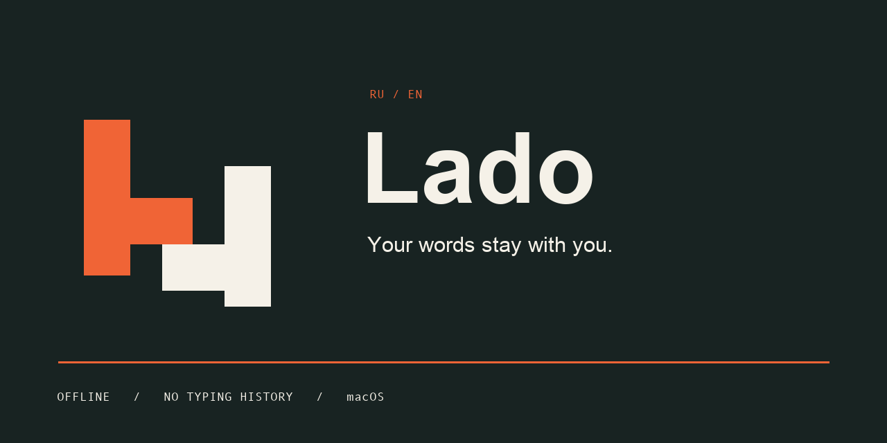

<p align="center"></p>

<p align="center"><b>Русский</b> · <a href="README.md">English</a> · <a href="docs/ROADMAP.md">План</a> · <a href="docs/PRIVACY.md">Приватность</a> · <a href="https://github.com/sirdimitry/Lado/releases">Скачать</a></p>

# Lado

**rc.6 — незавершённая проверочная сборка:** проходят 145 изолированных тестов. Замена в WebKit не проходит живую проверку; работа в ChatGPT не подтверждена. Не считается рабочим релизом. [Текущий результат](docs/validation/webkit-0.1.1-rc.6-2026-10-31.json).

> **29 октября 2026: опубликованный DMG 0.1.0 пока не запускайте.** После запуска сообщено о потере управления Mac. Исправления защиты внесены в исходники; новая изолированная живая проверка macOS ещё не проведена. [Результаты и ограничения](docs/validation/safety-audit-2026-10-29.md).

Небольшое приложение в строке меню macOS для набора на русском и английском.
Забыли раскладку? `ghbdtn` → `привет`. **Двойной Shift** преобразует слово или
выделенный текст. Python и системные интерфейсы macOS. Версия для Windows — в плане.

**Локальная обработка текста. Без истории ввода, телеметрии, аккаунтов и подписки.**

Lado не отправляет набранный текст и не сохраняет его на диск. Для исправления
в оперативной памяти ненадолго остаётся небольшой ограниченный контекст. На диск
записываются только настройки и явно добавленные вами исключения.
[Подробности и границы защиты](docs/PRIVACY.md), включая нестандартные поля пароля.

## Состояние проекта

**0.1.0 — ранняя предварительная версия для macOS.** Это не обещание совместимости
со всеми редакторами. DMG для Apple Silicon доступен в
[GitHub Releases](https://github.com/sirdimitry/Lado/releases).
Реализованы общее ядро, адаптер macOS, меню, настройки и
упаковка в DMG. Пройденные и оставшиеся проверки перечислены в
[VALIDATION.md](docs/VALIDATION.md).

Установленная копия прошла 19 изолированных живых проверок в обычном и защищённом
полях macOS, а также 53 автоматические проверки. Остальные редакторы требуют
отдельной проверки совместимости. Если нужная операция Accessibility не
поддерживается, замена слова пропускается без удаления исходного текста.

Нейросети в этой версии нет: используются компактные локальные частотные словари.
Маленькую локальную модель планируется отдельно сравнить с этим алгоритмом по
точности, задержкам и расходу памяти.

## Возможности

- Один индикатор **RU / EN** в строке меню. При защищённом вводе прямо на нём появляется маленький замок.
- Автоматическое исправление уверенно распознанных ошибок на границе слова.
  Для однобуквенных слов учитывается окружение; иногда решение откладывается до
  следующего слова.
- Слова **ЦЕЛИКОМ ЗАГЛАВНЫМИ** автоматика не меняет.
- **Двойной Shift:** преобразование выделения, а без выделения — последнего
  наблюдавшегося слова, в том числе из одной буквы. Повторное нажатие возвращает
  исходный вариант.
- Сохранение выделения, если редактор позволяет им управлять. Предложения и
  абзацы преобразуются по клавишам, без перефразирования.
- Явные личные исключения, настройка учёта регистра и исключения приложений.
  Исключения слов не мешают ручному преобразованию.
- Выбор рабочей пары из установленной английской и русской раскладок. Остальные
  языки удалять не нужно: на них Lado приостанавливается.
- При обнаружении защищённого ввода — отключение обработки, очистка контекста
  и приглушённый значок с замком.
- Пауза, необязательный автозапуск, настройки и окно About со ссылками на автора.
- Проверка опубликованных релизов GitHub при запуске и раз в час; предложение
  скачать подходящий DMG новой версии. Автопроверка отключается в настройках.

Это **смена раскладки, а не перевод**: `hello` → `руддщ`. В смешанном выделении
буквы преобразуются в обе стороны; неоднозначная пунктуация следует за преобладающим
алфавитом. Обработка выделения не переключает активную раскладку.

## Установка на macOS

1. Скачайте **DMG для macOS arm64** в [Releases](https://github.com/sirdimitry/Lado/releases).
2. Перетащите **Lado.app** в **Программы** и запустите установленную копию.
3. Разрешите **Lado** доступ в **Системные настройки → Конфиденциальность и
   безопасность → Универсальный доступ**. macOS также может запросить
   **Мониторинг ввода**. В новых macOS раздел доступа может называться
   **Device Control and Data Access**. Разрешения относятся к конкретной установленной программе;
   запуск исходников имеет другую идентичность.
4. Включите английскую и русскую раскладки в macOS и выберите рабочую пару в Lado.

Предварительная сборка имеет **локальную подпись ad-hoc и не заверена Apple**.
macOS может потребовать разрешить открытие в разделе «Конфиденциальность и
безопасность». Для обычной работы права администратора/root не нужны.
После обновления сборки ad-hoc может понадобиться удалить старую запись Lado
из разрешений и добавить установленную копию заново: включённой старой строки
бывает недостаточно. Сборки для Intel и Windows пока не предоставляются.

По умолчанию исключены Terminal, iTerm, VS Code, Xcode и распространённые bundle ID
1Password. Список доступен в настройках. Менеджеры паролей с другими идентификаторами
следует добавить явно.

## Обновления

Распознавание и преобразование текста работают без интернета. Необязательная
проверка обновлений обращается только к публичному API релизов GitHub: без набранного
текста, личных исключений, аккаунта и идентификаторов устройства. Учитываются
опубликованные версии, включая предварительные; черновики пропускаются.

При новой версии Lado предложит **«Обновить / Позже»**, дождавшись паузы в наборе
и не показывая окно в защищённом поле. Кнопка «Обновить» открывает загрузку
проверенного GitHub DMG в браузере. Установка — обычным перетаскиванием Lado
в «Программы», без скрытой замены работающего приложения. В меню также есть
**«Проверить обновления…»**.

## Как работает двойной Shift

Два коротких нажатия с отпусканием, по умолчанию с интервалом 400 мс. Shift,
использованный для заглавной буквы или сочетания клавиш, не считается.
После щелчка мышью, перемещения курсора, сочетания клавиш, смены поля или 30 секунд
бездействия старое слово забывается: приложение не пытается удалить текст по
устаревшей позиции. Более ранний фрагмент можно выделить.

Предел выделения — **65 536 единиц UTF-16**. Для точного обратного преобразования
временно хранится только последняя операция. Буфер обмена не используется.
Сохранение сложного форматирования зависит от редактора и не гарантируется.

## Разработка

Целевая система — macOS 13+, Python 3.11+. Первая сборка — для Apple Silicon.
Из папки клонированного репозитория:

```sh
python3 -m venv .venv
source .venv/bin/activate
pip install -e '.[build]'
python -m unittest discover -s tests -v
python -m lado --self-test
python -m lado
python scripts/build_macos.py
```

Компактные словари уже входят в репозиторий; для работы приложения `wordfreq`
не нужен. Дополнительные инструкции — в [BUILDING.md](docs/BUILDING.md).

## Материалы проекта

- [Поэтапный план с галочками](docs/ROADMAP.md)
- [Приватность и безопасность](docs/PRIVACY.md)
- [Архитектура](docs/ARCHITECTURE.md)
- [Сборка приложения и DMG](docs/BUILDING.md)
- [Проверки и ограничения](docs/VALIDATION.md)
- [Логотип, иконка и баннер](assets/brand/README.md)

Автор: **[@sirdimitry](https://x.com/sirdimitry)** · [GitHub](https://github.com/sirdimitry)

Код Lado: [MIT](LICENSE). Адаптированные словари: CC BY-SA 4.0 с включёнными
[сведениями об авторах wordfreq и корпусов](src/lado/data/NOTICE.md). Шрифты в
приложение не включены.
